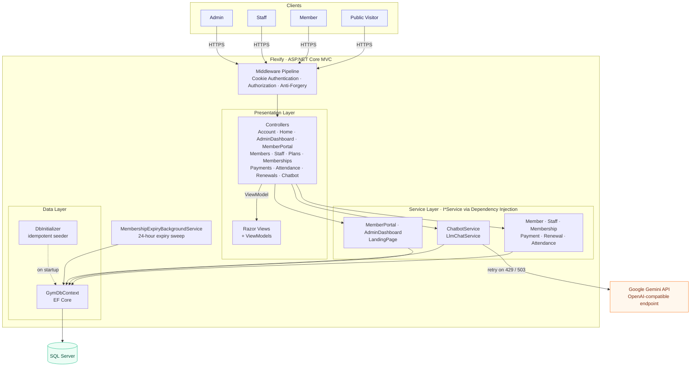
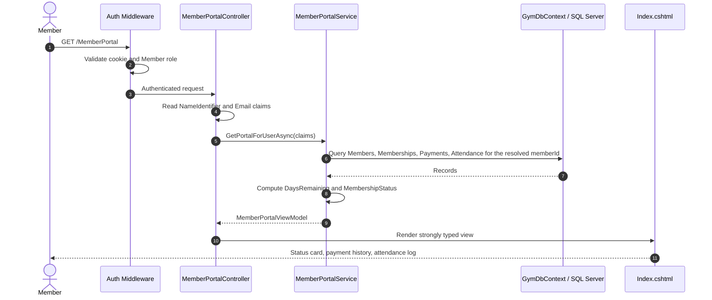
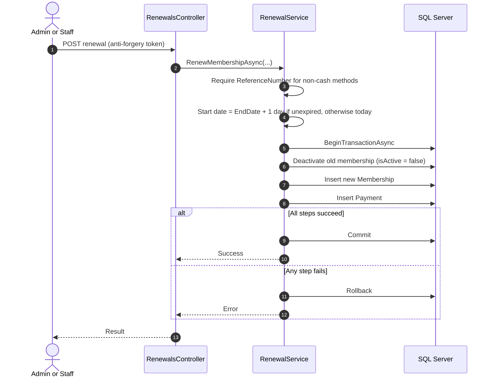
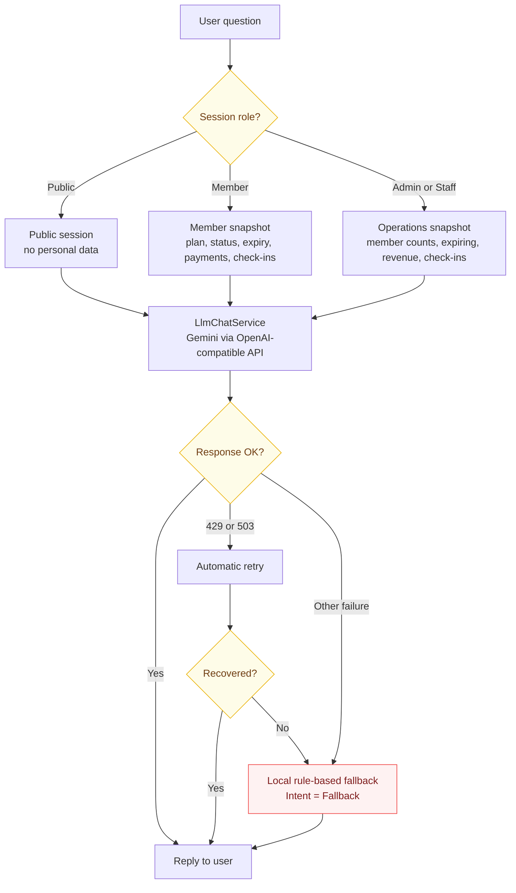

# Flexify

> A role-based gym management platform built with ASP.NET Core MVC, Entity Framework Core, and SQL Server — featuring membership lifecycle management, atomic payments and renewals, a member self-service portal, an analytics dashboard, and an AI front-desk assistant powered by Google Gemini.
> 


[](https://flexify-hacq.onrender.com/)

**🌐 Live demo:** [https://flexify-hacq.onrender.com/](https://flexify-hacq.onrender.com/)

---

## Table of Contents

- [Overview](#overview)
- [Live Demo](#live-demo)
- [Features](#features)
- [Architecture](#architecture)
- [Tech Stack & Dependencies](#tech-stack--dependencies)
- [Project Structure](#project-structure)
- [Getting Started](#getting-started)
- [Demo Accounts](#demo-accounts)
- [Testing](#testing)
- [Miscellaneous](#miscellaneous)

---

## Overview

**Flexify** digitizes the day-to-day operations of a gym: registering members, selling and renewing memberships, recording payments, tracking attendance, and giving owners real-time insight into the business. It serves three audiences through a single application:

| Role | Primary workspace | What they do |
| :--- | :--- | :--- |
| **Admin** | `/AdminDashboard` | Monitor KPIs, manage staff, plans, and members, void payments, and perform permanent deletes |
| **Staff** | `/Attendance` | Run the front desk: check members in/out, take payments, process renewals, upload receipts |
| **Member** | `/MemberPortal` | View subscription status, days remaining, payment receipts, and check-in history |

An **anonymous public landing page** advertises active membership plans, facility hours, and contact details, and an **AI chatbot** answers questions in a role-aware way (public visitors, members, and staff/admins each get relevant context).

**Design goals**

- **Correctness first:** money and membership changes are wrapped in database transactions.
- **Security by default:** role-based authorization, CSRF protection, and claims-scoped data access to prevent IDOR.
- **Maintainability:** thin controllers, interface-backed services, and SOLID principles enforced through automated reflection tests.

---


## Features

### Membership & Operations
- **Members CRUD** with soft deactivation (`isActive = false`)
- **Membership plans** defined by name, duration in days, and price
- **Plan assignment** with automatic `EndDate = StartDate + DurationDays`
- **Real-time membership status:** `Active`, `Expiring` (within 7 days), `Expired`, `Inactive`
- **Admin-only Staff management**

### Payments & Renewals
- **Atomic payment flow:** membership creation and payment recording commit together or roll back together
- **Non-destructive voiding** of receipts (`isVoided = true`) with confirmation
- **Date and member filters** on payment history
- **One-click renewal engine** with a 7-day expiring / recently expired queue for Admin and Staff
- **Renewal date continuity:** unexpired renewals start on `CurrentEndDate + 1 day`, preserving paid days; expired or unassigned renewals start today
- **Reference number enforcement** for non-cash methods (`GCash`, `Maya`, `Bank Transfer`, `Card`)
- **Receipt OCR upload** for front-desk payment entry
- **Background expiry worker** (`MembershipExpiryBackgroundService`) that sweeps and deactivates past-due subscriptions every 24 hours

### Attendance
- Member search check-in and check-out
- Blocks check-ins for expired, inactive, or deactivated members
- Enforces **one open check-in per member per calendar day**
- `checkOut > checkIn` validation at the model level

### Dashboards & Portals
- **Admin Analytics Dashboard** with five live KPIs:
  - Active Members
  - Subscriptions Expiring in 7 Days
  - Monthly Non-Voided Revenue
  - Check-Ins Today
  - New Members This Month
  - plus Chart.js visualizations: 7-day check-in series and 6-month revenue series
- **Member Self-Service Portal:** read-only subscription card, payment receipts, and attendance log
- **Public Landing Page:** active plans sorted by price and duration, facility hours, and contact details, with no extra database tables
- **Role-based post-login routing** straight to each user's workspace

### AI Front-Desk Chatbot
- Floating chat widget available on every layout page
- **Live Gemini integration** through Google's OpenAI-compatible endpoint
- **Resilient by design:** automatic retry on transient `429`/`503` responses, then a local rule-based fallback when the LLM is unavailable
- **Role-aware context:**
  - *Members:* verified plan, status, expiry date, days remaining, latest non-voided payment, recent check-ins
  - *Admin/Staff:* live active/inactive member counts, expiring memberships, monthly revenue, today's check-ins
- **Dynamic suggested prompts** tailored to Public, Member, or Staff/Admin sessions

---

## Architecture

Flexify uses a **layered, interface-driven MVC architecture** that separates HTTP orchestration, business rules, data access, and presentation.

### System Overview



### Layer Responsibilities

| Layer | Responsibility |
| :--- | :--- |
| **Models** | Domain entities mapped to SQL Server via EF Core; validated with Data Annotations and `IValidatableObject` |
| **ViewModels** | Per-module DTOs that prevent over-posting and decouple database schema from UI contracts |
| **Data** | `GymDbContext` (keys, relationships, decimal precision) and `DbInitializer` (idempotent seeder) |
| **Services** | All domain logic behind `I*Service` interfaces, registered through Dependency Injection in `Program.cs` |
| **Controllers** | HTTP routing, `[Authorize]` role policies, `[ValidateAntiForgeryToken]`, `ModelState` validation |
| **Views** | Strongly typed Razor templates with a role-aware navigation shell in `Views/Shared/_Layout.cshtml` |

### Key Services

| Service | Highlights |
| :--- | :--- |
| `MembershipService` | Computes `EndDate` and derives real-time membership status |
| `PaymentService` | EF Core transaction (`BeginTransactionAsync`) wrapping membership creation and payment recording; non-destructive voiding |
| `RenewalService` | Atomic renewal: deactivate old membership, create new one, insert payment, with full rollback on failure |
| `AttendanceService` | Expired/inactive check-in blocks and single open check-in per day |
| `MemberPortalService` | Resolves the member exclusively from authenticated claims and rejects cross-member ID lookups (IDOR prevention) |
| `AdminDashboardService` | KPI and chart aggregations, null-safe on empty tables |
| `LandingPageService` | Public, active-only plan listing |
| `ChatbotService` / `LlmChatService` | Role-aware context building, Gemini calls with retry, offline fallback matcher |

### Security Model
- **Authentication:** cookie authentication; claims populate `HttpContext.User`
- **Authorization:** class- and action-level `[Authorize(Roles = "...")]` for `Admin`, `Staff`, `Member`; `[AllowAnonymous]` only on public endpoints
- **CSRF:** `[ValidateAntiForgeryToken]` on every state-mutating `POST`
- **IDOR prevention:** member data is resolved from session claims, never from client-supplied IDs
- **Secrets:** LLM credentials are stored with `dotnet user-secrets`, never in source control
- **SQL injection:** LINQ is translated to parameterized SQL by EF Core; read-only queries use `.AsNoTracking()`

### Example Request Flow — Member Portal

1. An authenticated `Member` requests `GET /MemberPortal`.
2. Cookie authentication validates the session; `[Authorize(Roles = "Member")]` verifies the role.
3. `MemberPortalController` extracts `ClaimTypes.NameIdentifier` and `ClaimTypes.Email`, then calls `IMemberPortalService.GetPortalForUserAsync(...)`.
4. `MemberPortalService` queries `Members`, `Memberships`, `Payments`, and `Attendance` filtered by the resolved `memberId`, computes `DaysRemaining` and `MembershipStatus`, and builds `MemberPortalViewModel`.
5. `Views/MemberPortal/Index.cshtml` renders the status card, payment history, and attendance log.



### Atomic Renewal Flow

Renewals are all-or-nothing: the old membership is deactivated, the new one is created, and the payment is recorded in a single database transaction.



### AI Chatbot Flow

The assistant builds context from the signed-in role, calls Gemini, and degrades gracefully to a local matcher when the provider is unavailable.



### SOLID Principles in Practice

| Principle | Application |
| :--- | :--- |
| **SRP** | Controllers handle HTTP concerns only; services own queries and domain rules |
| **OCP** | New plan durations/pricing and scheduled sweeps extend behavior without editing controller actions |
| **LSP** | All `I*Service` implementations honor the same contracts on SQL Server and EF Core's `InMemory` test provider |
| **ISP** | Role-focused interfaces (`IMemberPortalService`, `IAdminDashboardService`, `ILandingPageService`, `IRenewalService`) instead of one monolith |
| **DIP** | Controllers depend only on `I*Service` abstractions; no direct `GymDbContext` injection in domain controllers |

---

## Tech Stack & Dependencies

| Category | Technology |
| :--- | :--- |
| **Framework** | ASP.NET Core MVC (C#) |
| **ORM / Data** | Entity Framework Core (code-first, migrations) |
| **Database** | Microsoft SQL Server |
| **Views** | Razor (`.cshtml`), strongly typed ViewModels |
| **Authentication** | ASP.NET Core Cookie Authentication with role-based authorization |
| **Background Jobs** | `BackgroundService` (hosted service) |
| **AI / LLM** | Google Gemini via OpenAI-compatible endpoint (`gemini-3.8-flash`) |
| **Charts** | Chart.js |
| **Testing** | xUnit, EF Core `InMemory` provider |
| **Version Control** | Git (`main` / `develop` / `feature/*` / `fix/*`) |

> Exact package versions are defined in the project's `.csproj` files.

---

## Project Structure

```text
Flexify/
├── Controllers/          # Thin HTTP controllers (Account, AdminDashboard, Attendance,
│                         #   Home, MemberPortal, Renewals, Chatbot, ...)
├── Data/
│   ├── GymDbContext.cs   # EF Core context: keys, relationships, decimal precision
│   └── DbInitializer.cs  # Idempotent Ensure*Async demo/role/account seeder
├── Migrations/           # EF Core code-first migrations
├── Models/               # Domain entities: Users, Staff, Members, MembershipPlans,
│                         #   Memberships, Payments, Attendance
├── Services/             # I*Service interfaces + implementations, incl.
│                         #   LlmChatService, ChatbotService, background expiry worker
├── ViewModels/           # Per-module DTOs: Account, Members, MembershipPlans,
│                         #   Memberships, Payments, Attendance, MemberPortal, AdminDashboard
├── Views/
│   ├── Shared/           # _Layout.cshtml (role-aware nav), _ChatbotWidget.cshtml
│   └── <Module>/         # Strongly typed Razor views per controller
├── wwwroot/
│   ├── assets/           # Static images (e.g., chatbot launcher icon)
│   ├── css/site.css      # Responsive styles and micro-interactions
│   └── js/site.js        # Chatbot widget and receipt OCR client logic
├── Program.cs            # DI registrations, middleware pipeline
├── appsettings.json      # Non-secret configuration
└── *.Tests/              # xUnit test project (services, business rules, access control)
```

---

## Getting Started

### Prerequisites
- A .NET SDK compatible with the project's target framework
- Microsoft SQL Server (LocalDB, Express, or full)
- *(Optional)* Azure SQL for deploying in Render
- *(Optional)* A Google AI Studio API key for live chatbot responses

### Installation

```bash
# 1. Clone the repository
git clone https://github.com/leiandrei/Flexify.git
cd Flexify

# 2. Restore dependencies
dotnet restore

# 3. Update the SQL Server connection string in appsettings.json,
#    then apply migrations
dotnet ef database update

# 4. Run the application (DbInitializer seeds roles, accounts, plans, and demo data on startup)
dotnet run
```

### Configure the AI Chatbot (optional)

Without an API key, the chatbot runs on its local fallback matcher. To enable live Gemini responses:

```bash
dotnet user-secrets set "Llm:ApiKey"  "<your-api-key>"
dotnet user-secrets set "Llm:BaseUrl" "https://generativelanguage.googleapis.com/v1beta/openai/"
dotnet user-secrets set "Llm:Model"   "gemini-3.8-flash"
```

---

## Testing

```bash
dotnet test
```

The suite was at **53/53 passing** at `v0.2.0` and has grown since.

| Suite | Verifies |
| :--- | :--- |
| `MemberPortalServiceTests` | Claims-scoped isolation, remaining-day math, cross-member IDOR blocking |
| `AdminDashboardServiceTests` | All 5 KPIs, voided-payment exclusion, chart aggregations, Admin-only RBAC |
| `LandingPageServiceTests` | Active-only plans, price sort, empty-table safety, `[AllowAnonymous]` |
| `RenewalServiceTests` / `BusinessRulesTests` | Renewal start-date rules, transaction rollback, non-cash reference validation, duplicate check-in prevention, expiry sweep |
| `Tier1EdgeCaseTests` | Unassigned member defaults, deactivated check-in block, empty-database KPIs |
| `SolidArchitectureTests` / `AccessControlTests` | Reflection audit of `I*Service` implementations, no direct `GymDbContext` in domain controllers, exact `[Authorize]` role policies |
| `ChatbotServiceTests` | Intent handling and fallback behavior |

---

## Miscellaneous

### Branching Strategy

| Branch | Purpose |
| :--- | :--- |
| `main` | Tagged releases only (`v0.1.0`, `v0.2.0`) |
| `develop` | Integration branch; all work merges here via Pull Request |
| `feature/*` | Isolated module development (e.g., `feature/payments`, `feature/attendances`) |
| `fix/*` | Defect resolution and security hardening (e.g., `fix/access-control`) |

### Release History

| Version | Milestone | Highlights |
| :--- | :--- | :--- |
| **v0.1.0** | Sprint 1 | Project setup, data model, cookie auth, Members/Plans/Staff/Membership CRUD, payments, attendance, access-control audit |
| **v0.2.0** | Phase 2 | Member portal, admin analytics dashboard, public landing page, renewal engine and expiry worker, role-based routing, SOLID refactor |
| **Phase 3** | Finalization | AI chatbot with live Gemini and fallback, responsive UI refinements, expanded idempotent demo seeding |

### License
This project is licensed under the [MIT License](LICENSE).